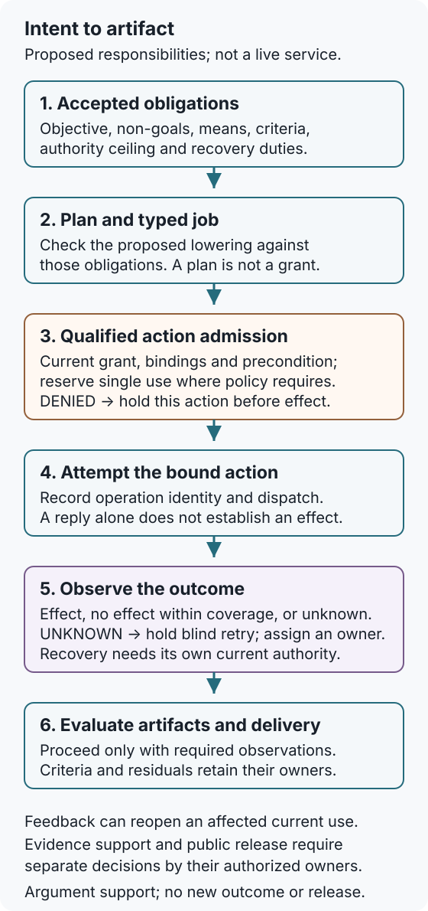

## Chapter status

| Field | Value |
|---|---|
| Chapter ID | `intent-to-execution-contracts` |
| Part | Part II - Planning, Memory, Reasoning, and Execution |
| Status | conceptual |
| Manuscript maturity | v0.3 layered instruction identity |
| Last updated | 2026-10-11 (source argument and diagrams; recorded results retain their dates) |
| Primary source records | `viea`, `talos`, `software_magic_grimoire`, `genesiscode`, `moecot`, `cognitive_compilation`, `ext_camel_prompt_injection_2025`, `cca_project`, `moecot_manifest_project`, `beastbrain_project`, `bugbrain_project`, `corbens_best_model_possible_project`, `reflexive_router_whitepaper` |
| Claim label | Design rationale |
| Evidence level | argument |
| Source queue | primary: `viea`, `software_magic_grimoire`; supporting: `talos`, `genesiscode`, `cognitive_compilation`, `cca_project`, `moecot_manifest_project`, `beastbrain_project`, `bugbrain_project`, `corbens_best_model_possible_project`, `reflexive_router_whitepaper`; comparator: `ext_camel_prompt_injection_2025`; connector/recovery: `moecot` |
| Source loading state | source notes: `viea`, `deterministic_capability_compilation`, `talos`, `software_magic_grimoire`, `genesiscode`, `moecot`, `cognitive_compilation`, `ext_camel_prompt_injection_2025`, `cca_project`, `moecot_manifest_project`, `beastbrain_project`, `bugbrain_project`, `corbens_best_model_possible_project`, `reflexive_router_whitepaper`; raw cache: `viea`, `talos`, `software_magic_grimoire`, `genesiscode`, `cognitive_compilation`; connector/recovery: `moecot` |
| Test state | Existing protocol, plan-execution, handoff, replacement-bridge, one-shot-action, and negative natural-work campaigns remain in force. The vertical refinement now requires 37 exact Lean declarations, kind-exclusive event payloads, arbitrary-run vertical invariants, one delivery witness, and eighteen closed countermodels; its independent consumer checks an executed nine-scenario governed repository-change result with 89 events and 30/30 rejected mutations. No general semantic equivalence, natural-language parser, authentic receipt, deployed approval service, complete effect, production transfer, or reliable useful-execution result is established. |

The executed merge combines two current record families:

- intent-to-execution traces, which ask whether accepted intent, constraints, approvals, artifacts, handoffs, dispatch receipts, evidence updates, feedback, stop/fault states, and residuals remain linked from request to delivery;
- command contracts, which ask whether objective, context, constraints, procedure, output contract, verification, failure behavior, field provenance, field confidence, bounded defaults, authority basis, re-contract points, and dispatch blockers are explicit before planning or execution can proceed.

## Drafting guardrail

A command contract is not the same thing as a working parser or a secure
dispatcher. It is the record a governed stack needs before parser quality,
planner handoff, runtime enforcement, approval behavior, and artifact
traceability can be tested honestly.

The argument does not ask readers to believe that a model can
extract intent perfectly. It asks a narrower systems question: once
intent has been accepted for work, what semantic fields, authority limits,
receipts, artifacts, verification paths, failure behavior, and residuals must
survive before tools or runtimes act?

::: {.asi-human-only}
## Human Reading Path

**Concrete lens.** A correct summary can still use a forbidden method. A competent ordinary workflow checks the requested task, current permission, actual change, and recovery; the proposed contract makes those obligations explicit across several representations and owners.

A person can ask for a complicated thing in ordinary language, with examples,
hopes, limits, and uncertainty. A system should not treat that ordinary
language as unlimited permission.

The first operational move is translation. The request becomes a contract that
separates what the person wants from what the system is allowed to do, what it
must produce, how success will be checked, what failure means, and when it has
to stop or ask again. The contract is not a bureaucratic form. It is the
boundary that prevents a helpful response from turning into an unauthorized
action.

The path starts where the Human Intent layer hands off. The raw request
has been captured, ambiguity has been bounded or escalated, and authority has
been scoped. Now the stack needs a command object that planners, verifiers, job
runners, runtime adapters, evidence ledgers, and later AI agents can all read
without guessing.

The contract makes uncertainty available to the owner who must decide what can
continue. An existing grant may already cover the work. Missing permission for
an external upload can block that upload while leaving an authorized local
summary available; it need not turn the entire request into another approval
form. Recording the distinction helps review, but only an enforced boundary
can prevent the forbidden action.
:::

## Problem

After an intent owner accepts a request, every lowering into commands, plans,
jobs, tool calls, effects, artifacts, verification, delivery, and residuals can
change meaning or authority. A governed stack therefore needs a
consumer-relative conformance contract that can detect semantic loss,
unauthorized amplification, response-for-effect substitution, and incomplete
delivery across the complete lineage rather than merely recording that each
stage exists.

This is the distinct conformance interface. Human Intent owns interpretation and
acceptance. Planning owns decomposition. Cognitive Compilation owns lowering.
Runtime layers own capability enforcement and effects. Artifact Graphs own
durable lineage. Intent-to-Execution Contracts owns the relation those layers
must preserve between the accepted receipt and the terminal outcome. It asks
whether the same objective, non-goals, constraints, affected parties,
authority, state assumptions, allowed means, output and effect postconditions,
verifier, stop rules, failure behavior, and residual duties survived each
transformation.

## Why existing approaches are insufficient

Prompt templates, typed schemas, planning languages, workflow engines,
capability systems, approval dialogs, event logs, provenance graphs, and formal
route theorems each constrain part of the path. None alone proves that the
accepted obligation survived every representation and material effect.

Field presence is not semantic agreement. A digest is not meaning. A dispatch
receipt is not an observed effect. A fluent response is not delivery. A
self-reported verifier is not independent acceptance. A zero-release route is
not useful or safe execution. The current evidence illustrates each boundary:
the synthetic fixtures trust hand-authored fields; the Lean theorems prove
finite consequences from declared predicates; the first governed-work route
released nothing; the 36-transaction campaign found only two correct model
candidates; the first natural final-contract campaign emitted no parseable
outputs; and the repaired renewal produced only two correct candidates, no
useful release in either arm, and a frozen denominator error.

ReAct, PDDL, SHOP2, Temporal, Airflow, BPMN, TLA+, Dafny, and CaMeL remain
comparators for action traces, explicit planning, durable workflows,
specification, verification conditions, control/data separation, and
capability enforcement. They are not local reproduction evidence for this
repository. An application built with ordinary tools may implement the same
end-to-end relation; naming it does not establish a new security primitive.

### When ordinary change control is enough

Consider a reviewed repository change with an accepted request, a current
scoped grant, pinned inputs, a conditional write, a diff and test review, and
an observed recovery procedure. If the same owner can check all the relevant
obligations in that workflow, a separate contract service may add only duplicate
state and maintenance. It should be allowed to win at lower total cost.

The proposed composition becomes a candidate when several lowerers and owners
must preserve the same non-goals, authority ceiling, criteria, and recovery
duties. Its prospective comparison is the [conventional authority and change
workflow](../docs/defended_contribution_prior_art_positioning.md). That comparison
matches tasks, grants, available tools, useful opportunities, and outcome
horizons, then asks whether the explicit joins prevent a particular lost
obligation at an acceptable cost. It has been specified, not executed as a new
head-to-head comparison.

Two comparators expose different parts of this problem. The [Temporal Activity
definition documentation](https://docs.temporal.io/activity-definition#idempotency)
explains that a worker can finish an action and fail before reporting it; a
retry can then execute the action again. It recommends idempotent Activities
and describes keys enforced by the called service. Durable orchestration does
not by itself supply exactly-once external effects. CaMeL's [version-one
paper](https://arxiv.org/html/2503.18813v1) separates trusted query control from
untrusted tool data and applies capability policies. Its threat model assumes
a trusted user prompt, and its reported failure analysis includes query
misunderstanding and tasks whose actions depend on untrusted data. These are
useful design comparisons, not local efficacy results or guarantees of correct
intent interpretation.

## Core Claim

[intent-to-execution-contracts.core, label: Design rationale, support: argument]
Intent-to-Execution Contracts should own a versioned, consumer-relative
conformance relation between an accepted intent receipt and the complete
execution lineage. Before any material dispatch, the relation binds exact
objective and non-goals, semantic fields and precedence, authority ceiling and
affected parties, state and environmental assumptions, allowed and forbidden
means, artifacts and effect postconditions, verification and independence
requirements, budgets and stop conditions, failure and compensation behavior,
expiry and re-contract triggers, and the required receipts through plan, job,
adapter, observed effect, artifact, delivery, feedback, and residual custody.
Each lowering or effect must either preserve that relation under independently
checkable evidence or stop, narrow, clarify, re-contract, compensate, or leave
an explicit residual.

The contract cannot infer human intent, grant authority, choose a plan, make a
tool safe, prove semantic equivalence, establish verifier correctness, or count
non-release as useful execution by itself. All chapter-core support therefore
remains at `argument`.

**Reader claim.** Execution remains faithful only while every lowering preserves the accepted objective, non-goals, authority, means, stop conditions, evidence, and residuals; a helpful change of means can still violate intent.

**Operational rule.** Preserve the accepted obligations and current authority through each lowering. Continue allowed choices under an existing valid grant; hold the affected action when it exceeds that envelope or lacks required evidence. Record actual effects, unknown outcomes, and recovery separately. A useful output, complete receipt, or recovery plan cannot substitute for those observations.

### Worked vertical trace: the output is right, the means are forbidden

In this hypothetical teaching case, an accepted contract asks for a public project summary and forbids uploading private source files. Planning lowers the task into a typed job; the job chooses an external summarization service that would receive the entire repository. The service might produce the correct summary, but the dispatch payload violates the forbidden-means field before any effect occurs. The required decision is to reject that upload and return to planning for an authorized local or source-minimized route. Choosing such a route within the accepted envelope needs no new permission merely because the implementation changed.

If an adapter nevertheless sends data, later output quality cannot repair the authority and means breach. The required record separates the attempted upload, what an observer can establish, any unknown disclosure, and the recovery owner's remaining duties. Deleting a local copy cannot undo a recipient's access. Whether quarantine or another recovery action is appropriate depends on that boundary and current authority.

The existing local refinement is a separate authored result: it follows nine scenarios containing 89 events and six material effects, with 30 source mutations. It checks exact payload and custody ordering across a ten-event delivery witness, but it trusts the authored semantics, authority, receipts, observations, and rollback fields; it does not prove parser correctness, semantic equivalence, tool safety, or effect truth.

## Intent to artifact: admission and observation {#draft-key-figure-intent-to-artifact-trace}

**Text version.** Accepted intent supplies the obligations. Planning and typed
jobs propose how to meet them; their conformance review checks for lost meaning
or widened scope. The actual candidate action then meets a current authority
and precondition check at a qualified admission boundary. Denial stops that
action before effect. An admitted attempt is followed by observation, which
may establish an effect, establish no effect within its coverage, or leave the
outcome unknown. Unknown outcomes hold blind retries and go to an accountable
owner. Artifact evaluation and delivery follow the observations and criteria
they require. Feedback can reopen an affected decision; evidence support and
public release still require their separate owners.

::: {.asi-key-figure tabindex="0" role="region" aria-label="Intent-to-artifact diagram; scroll horizontally if needed. The complete text version is above."}
{#fig-intent-to-artifact-trace style="min-width: 560px;" fig-alt="Six-stage proposed path from accepted obligations to planning, current authority admission, an attempted action, outcome observation, and artifact evaluation and delivery. Denial holds the action; an unknown outcome holds blind retry. Full text version precedes the figure."}
:::

**How to read the figure:** The gate precedes the attempted effect, and the
observer follows it. A plan does not authorize dispatch, and a dispatch receipt
does not establish completion. The diagram describes proposed responsibilities;
it is not an implemented service, an evidence transition, or release approval.

### Intent resolution before command lowering

The conformance relation begins with an accepted intent receipt; it does not
own the interpretation that produced one. This chapter owns typed lowering and
lineage conformance from accepted objective and non-goals through authority,
plan, job, approval, dispatch, observed effect, artifact, verification,
delivery, feedback, and residual custody. [Human Intent as a Formal
Input](human-intent-as-a-formal-input.qmd) is the stable technical-detail owner
for preserving the raw request, separating desired outcome from allowed and
forbidden means, extracting only supplied authority, recording affected
parties and boundaries, classifying assumptions and ambiguities, and managing
clarification, revocation, appeal, expiry, and re-contract.

The placement blocks assumption laundering in both directions. A well-formed
intent contract does not prove that the interpretation is complete, consent is
informed, authority is authentic, or downstream execution conforms. A
conformant execution lineage does not prove that the accepted interpretation
captured the person's real preference or every affected party's authority.
The parent does not inherit intent-understanding or consent claims; the
technical route does not inherit lowering, tool, effect, artifact, rollback,
or delivery claims. Both retain separate sources, claims, proof targets,
tests, failures, evidence exits, support ceilings, IDs, and URLs. Composition
creates no permission, semantic equivalence, useful outcome, support,
deployment, or release result.

## Mechanism

The mechanism begins only with an accepted intent receipt. It creates a
versioned command contract whose fields carry stable identities, units,
quantifiers, precedence, provenance, confidence, materiality, defaults,
unknowns, consumers, verifiers, and downstream consequences. Context,
retrieved material, examples, tool output, and model reasoning remain data; an
authorized control boundary must adopt them before they can change a command.

The contract defines a conformance edge for each lowering: accepted intent to
command, command to plan, plan to typed job, job to adapter request, request to
independently observed effect, effect to artifact, artifact to verification and
delivery, and delivery to feedback, compensation, and residual custody. Each
source obligation records its downstream representation, transformation rule,
permitted loss, consumer, verifier, and failure consequence. A material change
outside the accepted envelope creates a new contract version or a re-contract
request. A permitted implementation choice records its binding without
requiring the user to approve the task again.

Conformance is evaluated per consumer and per obligation, not as one document
status. A lowering can preserve an objective while dropping a forbidden means,
preserve authority while changing the target state, or produce the requested
file without causing the accepted external effect. Each edge therefore needs a
typed comparison result, the exact source and target representations, the
observer that made the comparison, uncertainty and disagreement, and the
downstream consequence of failure. Missing information blocks or narrows only
the affected obligation when that can be done without changing meaning.

Before dispatch, conformance checks the proposed action and its preconditions;
it cannot require an observation of an effect that has not happened. After an
attempt, a declared observer checks actual outcomes and their coverage. A
receipt records an assertion about that check; its identity alone cannot make
the assertion true or independent.

The lifecycle is also bidirectional. Runtime observations, artifact evaluation,
delivery failure, user correction, delayed harm, or incomplete compensation can
challenge an earlier conformance judgment. Flag the affected current uses for
their owners and route repair, re-contract, recovery, or residual custody.
Historical decisions retain their identities and permitted records; current
eligibility can change without rewriting an earlier result. Retention duties
do not override privacy or deletion rules.

### One-shot privileged action binding

A contract describes accepted work; a current grant authorizes a bounded use.
An existing grant can cover routine actions, permitted implementation choices,
and declared recovery. Fresh human approval is needed only where the policy
or changed scope requires it. A one-shot capability is appropriate when the
policy authorizes one particular transition rather than a reusable bounded
operation.

For that case, bind an operation identity to the principal, target identity,
observable precondition, canonical parameters, policy and grant versions,
expiry, and cumulative budget. A digest compares a declared representation,
not the entire world or the meaning of the request. The boundary must specify
what state it can check and how that check remains coupled to the mutation.
Current authority and revocation are evaluated at that qualified boundary;
this does not promise instantaneous revocation across disconnected services.

The single-use reservation must precede the effect. Within one local
transaction, serialize admission and couple the relevant precondition to the
mutation. Across a remote boundary, require a qualified receiver protocol
that binds the same operation identity to its deduplication and effect state.
A local reservation alone cannot guarantee exactly-once behavior at an
uncooperative remote service.

A permitted transport retry or status query for the same operation is different
from admitting a second effect. Retry only under the declared receiver's
idempotency contract and current retry authority. A timeout, missing receipt,
or expired lease must not silently make an unresolved operation available for
another effect. Record the unknown outcome, seek qualified observation, and
assign recovery or residual custody. Any compensating action needs its own
current authority; it is not a negative entry that erases the first attempt.

The five historical projects supply one local lineage of positive and negative
design pressure. CCA and MoECOT Manifest motivate typed request/effect records,
policy identity, and replayable receipts. BeastBrain and BugBrain expose the
danger of acknowledgement, simulated success, or a nominal state transition
standing in for an authorized material effect. Corben's Best Model Possible
adds the runtime-causality boundary: a named tool, transition, or digest is not
enough unless the exact authorized parameters reach the observed effect. These
are source-note and roadmap inputs, not five replications or evidence that any
historical implementation enforced the protocol.

::: {.asi-key-figure .intent-single-use tabindex="0" role="region" aria-label="Proposed single-use lifecycle; scroll horizontally if needed. Full description and hypothetical timeline follow."}
```{mermaid}
%%{init: {'theme': 'base', 'themeVariables': {'fontSize': '20px', 'primaryTextColor': '#18202a', 'primaryColor': '#f4f8fa', 'primaryBorderColor': '#256b7c', 'lineColor': '#256b7c', 'edgeLabelBackground': '#ffffff'}, 'flowchart': {'nodeSpacing': 16, 'rankSpacing': 32}}}%%
flowchart TD
  accTitle: Proposed single-use admission and outcome handling
  accDescr: Current bindings are checked before a single-use reservation and attempt. Denial prevents the action. Observation distinguishes known outcomes from unknown outcomes, which hold blind retries and require an owner. The diagram is a proposed protocol, not the existing historical record fixture.
  Check["Current grant,<br/>bindings + precondition"] --> Admit{"Admit one<br/>operation identity?"}
  Admit -- "no" --> Denied["Deny this action"]
  Admit -- "yes" --> Reserve["Reserve single use"]
  Reserve -- "reserved" --> Attempt["Attempt bound action"]
  Reserve -- "conflict" --> Denied
  Attempt --> Observe{"Outcome observed<br/>within coverage?"}
  Observe -- "yes" --> Known["Effect / no effect<br/>Close or recover"]
  Observe -- "no" --> Unknown["Unknown outcome<br/>Hold blind retry"]
```
:::


**Reading the proposed lifecycle:** Reservation prevents another local worker
from treating unresolved authority as unused. Observation determines what can
be said about the outcome; it does not authorize the action retrospectively.
The reservation is not rearmed by absence of a success receipt. Qualified
same-operation retries belong to the receiver protocol, not a fresh
single-use grant inferred from a timeout.

For example, suppose two workers receive operation `R17`. Worker A reserves it
and sends the request, then loses the reply. Worker B must not conclude that
`R17` is unused merely because the final receipt is absent. With qualified
receiver deduplication, it may query or make an authorized retry using `R17`;
without that guarantee, the outcome stays unknown. This is a hypothetical
failure timeline, not a concurrent execution result from this repository.

The historical one-shot fixture follows `requested → resolved → approved →
dispatched → effect_observed → consumed`. Its validator checks the recorded
bindings, ordered states, consumed nonce, and denial of a recorded replay. It
does not implement the pre-effect reservation above, concurrent admission, a
crash-safe grant service, or receiver deduplication. Keep that implemented
record check distinct from the stronger proposed protocol.

### Strongest objection

The strongest objection is that exact digests and a nonce can make an unsafe
action perfectly replay-resistant. That is correct. Binding proves neither
that the policy is wise nor that the approver understood the consequence.
Enforcing the declared binding is intended to prevent a grant for one
principal, state, parameter set, and policy from being reused for another;
merely recording those fields cannot do so. Policy quality, interface comprehension,
OS enforcement, and effect safety remain separate owners and residuals.

### Command contract validation states

Command contracts move through explicit validation states:

| State | Meaning | Allowed movement |
|---|---|---|
| `draft` | Fields are being extracted or normalized. | No planning dispatch. |
| `field_complete` | Required fields exist but may include inferred/defaulted values. | Validation and review only. |
| `conflict_detected` | Context, examples, hidden instructions, or fields conflict with explicit constraints. | Residual or clarification. |
| `authority_inferred` | A means, tool, disclosure, publication, or effect is inferred rather than granted. | Draft-only or re-contract. |
| `dispatch_blocked` | A requirement for the proposed effect is missing, vague, or unsatisfied. | Hold that action; permitted planning or narrower work may continue. |
| `validated_for_planning` | Required fields are concrete and precedence review passed. | May lower into a plan graph. |
| `superseded` | A newer command contract replaces the current one. | Preserve permitted history; current reuse requires its own eligibility decision. |

These are pre-execution states. In particular, `validated_for_planning` says that the contract can become planning input; it supplies neither dispatch authority nor evidence of a completed effect.

### Canonical events and command precedence

The Reflexive Router adds a pre-deliberative ingress contract before ordinary
command lowering. A canonical event envelope keeps `event_id`, authenticated
principal, issuance and receipt time, modality, tenant, privacy class,
authority handles, context handles, resource budget, literal payload, and
requested route constraints outside open-ended interpretation. The envelope
does not prove the payload is truthful or the request is permissible; it gives
those questions stable identities and prevents parser convenience from
rewriting their scope.

Four ingress modes should remain distinguishable throughout the trace:

1. unmarked natural-language input requesting automatic routing;
2. a forced route that names a semantic capability but permits no silent
   fallback;
3. a direct command whose typed arguments are bound without action
   interpretation; and
4. a compiled workflow whose nodes and dependencies are already explicit.

All four converge on the same authority, qualification, consequence,
verification, effect, and audit boundaries. The user-dispatch invariant is
therefore precise: an override may bypass inference, but never enforcement.
Untrusted text that merely resembles command syntax remains literal data unless
the authenticated command plane adopts it. A registry binding may expand only
into typed fields; it may not interpolate trusted shell, SQL, URL, or prompt
fragments.

The contract also owns fallback fidelity. `deny`, `defer`, `clarify`,
`quarantine`, `rollback`, `no_route`, and `contract_rejected` are distinct
terminal or remediation outcomes with reasons and residuals. If the requested
route is stale, unknown, unauthorized, or underqualified, the system reports
that fact and the exact fallback authority rather than presenting another route
as though it honored the command. These are proposed contract semantics from a
Corben-authored paper, not evidence that a parser or dispatcher implements
them; support remains `argument`.

### Instruction identity has layers

An instruction needs more than a memorable name. Software Magic Grimoire usefully
separates a human title, a short working seal, and an exact canonical form. The
governed version extends that into an **Instruction Identity Record**:

- human title and purpose;
- immutable instruction and contract version;
- canonicalization schema and normalizer version;
- ordered typed fields, relations, word-sense namespaces, and literal values;
- a standard cryptographic digest of that canonical record;
- redaction-safe identity for sensitive literals;
- model, runtime, policy, context, tool, environment, verifier, and consumer
  dependencies required to interpret or replay a run;
- supersession, compatibility, revocation, and migration history.

These layers answer different questions. A title makes the instruction
browsable. A working handle makes it portable. A canonical record detects
specified structural change. None proves semantic equivalence, correctness,
authorization, confidentiality, or successful replay. Gödel-style
prime-exponent numbering is one injective encoding of a chosen finite token
stream, not a solution to ambiguity; a versioned canonical record and ordinary
cryptographic digest are the practical identity surface.

Identity also includes choreography. Reordering workflow stages, changing a
transition guard, widening a default, removing a failure route, altering a loop
budget, or changing a recursive base case creates a new version even when the
human title stays the same. Concrete paths, versions, target names, and values
remain typed literals rather than disappearing because they are absent from a
shared vocabulary. This makes instruction drift inspectable without pretending
that hashes understand meaning.

### The command registry is a governed instruction set

An explicit command is not a trusted text macro. It is a versioned binding
between an authenticated name and a semantic route, capability, resource
profile, or workflow. Its descriptor declares owner and scope; aliases and
namespace; positional, named, optional, and defaulted parameters; permitted
context variables; authority and effect class; confirmation policy; budgets;
verifier; fallback; renderer; compatible capability versions; provenance;
review date; and revocation state. Routine invocation uses a conventional
lexer, parser, registry lookup, and typed argument binder. Natural language may
help author a descriptor once, but it does not reinterpret the binding on each
use.

Defaults are dependencies, not conveniences hidden from the trace. A command
that reads `$profile.default_location`, `$context.active_document`,
`$context.last_result`, or `$time.today` declares the dependency, scope,
freshness rule, and missing-value outcome. A supplied argument overrides a
default for that invocation without mutating the command. The resulting
dispatch receipt records both the requested route or effort profile and the
one actually realized; an unavailable high-effort profile cannot be silently
downgraded unless the contract explicitly authorizes that fallback.

Resolution is deterministic across reserved, fully qualified, session,
personal, workspace, shared, and platform namespaces. The interface must let a
principal inspect the active binding and shadowed alternatives, preview exact
effects, dry-run it, compare capability and authority diffs, disable it, view
history, and roll back a prior version. A model may propose a shortcut after
repeated use, but registration and any later expansion of authority,
consequence, target set, or hidden dependency require a separately authorized
mutation. Imported command packages remain executable supply-chain artifacts:
names such as `/morning` or `/weather` do not disclose their permissions.

Command-looking strings in documents, webpages, messages, quoted examples,
tool output, and model output remain inert data. Literal escaping and a small
non-overridable recovery namespace keep it possible to discuss a command,
inspect permissions, stop execution, or recover a damaged registry without
activating the named operation. These rules turn the user-visible vocabulary
into an inspectable personal instruction set without letting convenience
syntax acquire ambient authority.

### The capability charter as executable intent

Deterministic Capability Compilation gives the command contract a downstream
compilation target: the **capability charter**. The charter binds input and
output schemas, preconditions, postconditions, invariants, failures, authority,
cost, observability, recovery, uncertainty, non-goals, and accepted residuals
before an executable scaffold or learned replacement exists. It is narrower
than human intent but richer than a task description.

The scaffold is executable evidence about the charter, not the charter's full
meaning. Every lowering from accepted intent to charter, scaffold, semantic
capability graph, corpus, expert, NCO, linked route, and effect must retain a
semantic obligation ledger. A behavior present in the scaffold may still be a
specification defect; a human obligation absent from the scaffold remains
uncompiled rather than silently satisfied. This creates a precise re-contract
route when the student, environment, or tribunal exposes a missing or mistaken
requirement.

## Interfaces

Human Intent owns interpretation, ambiguity, consent and authority extraction,
affected-party coverage, bounded defaults, and acceptance. Constitutional,
moral-uncertainty, and system-authority owners supply prohibitions, rights,
delegated capabilities, and unresolved conflicts. The conformance layer consumes those
records and may narrow them; it cannot repair or widen them silently.

Planning owns decomposition and ordering. Cognitive Compilation owns semantic
lowering. Labor OS owns typed job lifecycle. Runtime Adapters and the Security
Kernel own capability enforcement and observed effects. Artifact Graphs own
durable identity. Verification, Evidence States, and Readiness Gates own
evaluation, support movement, and release. Resource Economics owns cumulative
cost. Rights, privacy, licensing, and publication owners retain their own
approval surfaces.

The contract's job is to make each handoff testable. The proposed consumer interfaces return a
conformance, blocked, attempt, effect, artifact, decision, delivery,
compensation, or residual receipt appropriate to their stage. Each assertion
needs an identified producer, observation coverage, and trust dependencies. A graph can therefore be complete while
semantically wrong; a runtime can enforce an authority token while executing
the wrong accepted task; and a verifier can accept a file that was never
delivered to the intended consumer. Those are separate failures, not one green
workflow state.


Each field carries confidence/provenance metadata:

| Field status | Meaning | Dispatch rule |
|---|---|---|
| `confirmed` | Explicitly stated or accepted by the user/governance boundary. | May support planning. |
| `policy_imposed` | Added by active policy, constitution, or safety rule. | May constrain planning; cannot broaden authority. |
| `source_derived` | Taken from an authorized source artifact. | May support context or requirements within source limits. |
| `defaulted` | Filled by a bounded default. | Must carry scope and re-contract trigger. |
| `inferred` | Guessed from context or pattern. | Cannot authorize side effects. |
| `missing` | Required value absent. | Blocks dispatch or narrows output to clarification/draft. |

This metadata keeps field confidence from becoming hidden evidence. A field can be useful and still too weak to authorize work.

## Invariants

These invariants are end-to-end obligations, not assurances supplied by a
schema. Each one requires exercised producers and consumers at every relevant
edge, rejecting mutations for ordinary and adversarial failures, and an
observed consequence when it fails. A field that is present but never changes a
decision remains documentation rather than control.

- Every material field has an authoritative source, precedence, provenance,
  confidence, consumer, verifier, and consequence; typed presence alone is
  insufficient.
- Objective, non-goals, constraints, parties, authority, forbidden means,
  state assumptions, budgets, stops, criteria, failure behavior, and residual
  duties remain traceable through every lowering.
- Context and untrusted content remain data unless an authorized control
  boundary adopts them; they cannot widen authority.
- An inference or default cannot create permission. A default may resolve a
  reference to an independently valid grant; stale, conflicting, or missing
  authority cannot authorize a material effect.
- Every material transformation either satisfies a declared conformance
  relation or produces a loss, ambiguity, repair, narrowing, or re-contract
  record before dispatch.
- Planning, compilation, routing, retries, fallbacks, and repair remain inside
  the accepted envelope.
- A privileged effect requires current grant and binding checks at a qualified
  admission boundary. Where policy requires single use, reserve it before the
  attempt and prohibit a second effect admission while its outcome is unresolved.
- Requested, planned, dispatched, acknowledged, attempted, observed,
  compensated, rolled back, verified, delivered, and useful remain distinct.
- Artifact identity includes contract version, producer lineage, receipts,
  criteria, evaluator, delivery, feedback, and residuals.
- Verifier dependencies, exposure, criterion version, error, and disagreement
  remain visible; self-report cannot silently become independent acceptance.
- Account for every attempt, failure, timeout, abstention, retry, discard,
  side effect, cost, compensation, and residual in the declared denominator.
  Preserve permitted accounting records rather than retaining forbidden payloads.
- Resource, privacy, rights, authority, and opportunity costs follow the whole
  lineage and cannot reset at handoffs.
- Material changes outside the accepted envelope trigger review of affected
  uses, revalidation, or re-contract; permitted choices can continue under a
  current grant. Historical decisions are not erased.
- A denial must prevent the denied action; it does not need a post-state for
  an effect that was never attempted. Stop, rollback, and compensation claims
  need observations appropriate to their coverage and an owner for residuals.
- A complete receipt asserts the recorded lineage. Authenticity, truthful
  observation, correct interpretation, wise policy, safe tools, useful
  execution, and production transfer need their own evidence.
- Zero dispatch or release is abstention, not evidence of usefulness or safety
  advantage without an estimable matched denominator.
- No component may approve its own broader authority, support state, or public
  release.

## Failure modes

The failure surface includes intent laundering, field laundering, semantic
drift, context injection, authority inference, approval drift,
acknowledgement substitution, replay laundering, response substitution,
effect-gap laundering, artifact identity loss, verifier capture, success
scalarization, denominator erasure, fail-closed theater, ceremonial recovery,
contract ossification, and governance-cost externalization.

The three most deceptive cases are ordinary. A model can produce plausible
prose while never satisfying the requested final contract. A governed route
can release nothing and look safe while producing no useful denominator. A
complete lineage graph can preserve every identifier while the meaning changed
during compilation. The conformance contract therefore requires semantic, authority,
effect, artifact, usefulness, safety, cost, and recovery outcomes to remain
separate.

## Minimum Viable Implementation

The current minimum now includes both the record-and-route scaffold and one
executed vertical refinement. Intent, command, and trace schemas; synthetic
plan-execution, handoff, replacement-bridge, and one-shot action fixtures; and
one consumed hand-authored five-project lifecycle remain. The reachable Lean
model adds explicit command, plan, job, authorization, dispatch, attempted and
observed effect, artifact, verification, delivery, rollback, residual, and
quarantine states. Its 37 exact declarations make event payloads
kind-exclusive and prove the vertical invariant across arbitrary accepted
runs: root-contract and authority-ceiling custody, bounded active authority,
monotone logical time, approval and dispatch custody, attempted and observed
effect accounting, artifact and independent-verification custody, exact
delivery accounting, stopped blocking, positive residualization, and failed-
rollback quarantine. One ten-event trace reaches delivery, while eighteen
closed countermodels reject custody substitution, stale time, smuggled
payloads, premature transitions, self-verification, inexact rollback, and
quarantine without residual custody. The independent consumer also checks the
complete nine-scenario governed repository-change result, 89 events, six
effects, six observations, two exact rollbacks, and thirty rejecting source
mutations.

The one-shot record check likewise validates authored records rather than
serializing live admission. None of these results exercises the proposed
concurrent reservation, crash recovery, or qualified remote retry protocol.

This is still a fixed local repository task with trusted event and receipt
fields. It tests concrete transition and result-schema conformance, not whether
a natural-language request retained its meaning through arbitrary lowering.

The empirical attempts are equally important to the minimum because they stop
the schema from masquerading as capability:

- 16 model runs produced zero governed releases and two inexact rollbacks;
- 36 transactions produced only 2/36 correct candidates and four inexact
  attack-control rollbacks;
- 12 natural-work tasks produced zero parseable final contracts; and
- the repaired renewal completed 32 candidates but produced only 2/32 correct
  candidates, zero useful releases in either arm, zero unsafe releases in
  either arm, and a frozen 8/8-versus-9/9 metadata discrepancy.

The later P4/M5 recampaign finally reached an informative regime without
rewriting those failures. After a 40-candidate tuning pool populated all four
useful/safe cells, a fresh 16-task held-out campaign admitted 15 candidates.
Two evaluator implementations agreed on every admitted row. The candidate's
self-release baseline released none; the frozen full-governance contract
released 9 useful and 0 unsafe candidates, while removing evidence freshness
released one additional useful-unsafe candidate. This is accepted only as the
bounded non-core claim
`governed-usefulness.held-out-local-policy-effect` at
`synthetic-test-backed`. It does not show that arbitrary natural-language
intent is lowered correctly, that self-release is the strongest baseline, or
that the effect transfers beyond one authored corpus and one quantized model.

An honest next minimum is a prospectively frozen natural multi-model contract
campaign with human-authored, direct, schema-only, and governed comparators;
independent semantic and effect observers; identical authority and candidate
conditions; exact lineage and cost; nonzero useful-release opportunity;
delayed outcomes; causal ablations; effect-complete recovery; replication; and
transfer. The current scaffold meets a narrow local policy-selection subclaim,
not that broader bar.

## Mature Research Target

The mature target is evaluated as a semantic and causal system, not a larger
prompt template. Prospectively sampled natural tasks compare human-authored
contracts, direct execution, schema-only extraction, strong workflow and
capability baselines, and the full governed route using identical models,
tools, data, authority ceilings, candidate bytes, budgets, and outcome
horizons.

Independent implementations score interpretation fidelity, obligation
preservation, authority precision and recall, untrusted-data separation,
plan/job conformance, observed effects, artifact satisfaction, useful
delivery, unsafe release, abstention, missed help, delayed harm, rights and
privacy effects, rollback and compensation completeness, latency, compute,
human labor, and total governance cost. Causal ablations test every claimed
mechanism. Adversaries attack ambiguity, injection, authority, replay,
evaluator capture, state drift, residual erasure, and cost hiding. Replications
span models, languages, modalities, task families, runtimes, organizations,
jurisdictions, threats, and time.

Promotion requires a nonzero useful denominator, effect-bearing controls,
strong matched baselines, independent evaluation, reproducible raw artifacts,
and accepted claim-specific transitions. Missing evidence leaves the
corresponding claim open or blocked. A negative result refutes only the
proposition and conditions it actually tests; a null comparison does not
establish either superiority or equivalence. This remains a research
target, not evidence of reliable intent extraction, safe useful execution,
production transfer, AGI, or ASI.

No current result meets this intent-preservation endpoint; support remains
`argument` until useful effect-bearing natural workloads, independent
evaluation, causal controls, reproduction, and transfer pass.

## Codex test plan

| Test | Purpose | Status |
|---|---|---|
| Contract field completeness test | Check that `intent_contract`, `command_contract`, and `intent_execution_trace` fixtures carry required objective, authority, output, verification, failure, handoff, artifact, feedback, residual, and non-claim fields. | implemented by protocol validation; validated locally |
| Constraint preservation test | Check that every accepted vertical edge preserves one root contract and exact artifact parent and cannot widen authority or apply hidden overrides. | implemented in `AsiStackProofs.IntentExecutionRefinement`; finite transition semantics only |
| Approval-gated execution test | Check that authorization and dispatch require approval/receipt custody and that effect and delivery require prior dispatch, observation, artifact binding, and independent verification. | implemented in `AsiStackProofs.IntentExecutionRefinement`; deployed approval-service behavior is not established |
| Command schema validation test | Check that command contracts expose objective, constraints, output contract, verification, and failure behavior before planning input is accepted, and that a missing required field blocks completeness. | implemented in `AsiStackProofs.CommandSemanticRefinement`, retained finite negative cases, and protocol fixtures |
| Failure-behavior declaration test | Check that missing failure behavior blocks dispatch rather than becoming an implicit best-effort command. | implemented by finite predicates and synthetic fixture checks |
| Execution dispatch route proof | Check that a finite dispatch review routes missing contracts, missing objective fields, authority widening, hidden overrides, missing approvals, missing artifacts, missing verification plans, known residuals, and complete dispatch reviews to explicit outcomes. | implemented by Lean build; finite-record route coverage only |
| Prompt override scenario | Check that hidden, retrieved, or conflicting instructions cannot override explicit contract constraints. | implemented as a reachable precedence transition, retained finite negative case, fixture classification, and mutations; not run against a deployed parser or model |
| Intent-origin preservation fixture | Check that explicit intent constraints, forbidden means, stop conditions, re-contract triggers, and authority ceiling survive into command and plan records. | implemented by synthetic plan-execution contract harness; no parser, dispatcher, or runtime claim |
| Ambiguity dispatch block fixture | Check that unresolved ambiguity cannot validate a command for planning or dispatch a plan. | implemented by synthetic plan-execution contract harness; no natural-language ambiguity parser claim |
| Hidden override rejection fixture | Check that hidden override requests must be rejected, quarantined, or ignored before planning. | implemented by synthetic plan-execution contract harness; no deployed prompt-injection containment claim |
| Intent-authority ceiling fixture | Check that a command contract cannot widen the explicit intent authority ceiling. | implemented by synthetic plan-execution contract harness; no deployed authority-extraction or approval-service claim |
| Field-confidence audit | Check that confirmed, policy-imposed, source-derived, defaulted, inferred, and missing fields preserve dispatch consequences. | implemented by the plan-execution fixtures plus reachable `AsiStackProofs.CommandSemanticRefinement` transitions; no parser-quality or deployed-dispatch claim |
| Authority-inference block test | Check that inferred means, tools, disclosure, publication, or side effects route to draft-only or re-contract states. | implemented by synthetic plan-execution contract harness; no deployed authority-extraction, approval-service, or runtime side-effect claim |
| Intent-to-execution handoff probe | Check that a synthetic vertical trace preserves accepted intent, command contract, plan, typed job, dispatch receipt, adapter receipt, artifact link, verification reference, feedback, residuals, and a missing-approval blocked path while rejecting approval bypass, authority widening, hidden override application, missing dispatch receipt, side effect without adapter receipt, residual erasure, and missing artifact-to-parent links. | implemented by `python3 scripts/validate_intent_execution_handoff_probe.py` with two valid synthetic handoff traces and seven expected-invalid controls; no parser, deployed dispatcher, approval-service, runtime-adapter, artifact-satisfaction, support-state-promotion, or evidence-transition claim |
| Intent-governed replacement bridge | Check that command-contract authority can feed a replacement transaction only when intent refs, command refs, authority ceiling, stop conditions, forbidden means, evidence requirements, canary scope, monitor window, rollback owner, residuals, and non-claims survive; also check that default replacement without approval is blocked. | implemented by `python3 scripts/validate_intent_governed_replacement_bridge.py` with two valid synthetic bridge traces and six expected-invalid controls; does not parse natural-language intent, execute a deployed dispatcher, prove approval-service behavior, execute replacement, execute rollback, promote support state, or create an evidence transition |
| One-shot privileged-action lifecycle | Bind approval to principal, exact target state, parameter digest, policy version, TTL, nonce, observed effect, post-state, and single-use replay denial; reject scenario acknowledgement as approval. | implemented by `python3 scripts/validate_one_shot_privileged_action.py` with one consumed five-project record and ten expected-invalid mutations; no approval service, privileged effect, OS enforcement, or support promotion |
| Executed vertical Intent-to-Execution refinement | Refine the reachable contract-to-delivery model against the complete executed governed repository-change result across release, pre-effect refusal, exact rollback, failed-rollback quarantine, residual custody, and concrete source mutations. | implemented by `python3 scripts/validate_intent_execution_vertical_refinement.py`: nine scenarios, 89 events, six effects and observations, two exact rollbacks, two residual scenarios, and 30/30 rejected mutations; support-state effect `none` |
| Executed command semantic-interface refinement | Bind and preserve exact objective, constraint, output, verification, failure, and authority slots with provenance/confidence, authority, blocker, approval, validation, and dispatch custody, while keeping interface validity separate from downstream validity. | implemented by `python3 scripts/validate_command_semantic_refinement.py`: 13 schema-valid command fixtures classified as five interface violations, two correct blocks, and six interface-admissible records; five reachable events; 38/38 rejected mutations; support-state effect `none` |

The current repository state supports synthetic contract tests plus one
source-anchored executed vertical refinement. That refinement is materially
stronger than field-shape proofs, but it remains one deterministic local task
and does not establish general semantic conformance or deployment.

The executed vertical consumer runs with
`python3 scripts/validate_intent_execution_vertical_refinement.py` and records
`experiments/intent_execution_vertical_refinement/results/2026-07-15-local.json`.
It validates the complete source result against its public schema, then checks
exact event order, accepted changed paths, artifact receipts, independent
effect observation and evaluator identity, refusal causality, rollback,
quarantine, and residual custody. Thirty mutations alter concrete source fields
and are all rejected. Its support-state effect is exactly `none`.

The Intent-to-execution handoff probe is the current vertical fixture. It runs
with `python3 scripts/validate_intent_execution_handoff_probe.py` and records
`experiments/intent_execution_handoff/results/2026-07-02-local.json`. It has
two valid synthetic handoff traces: one accepted command path from intent
receipt through command, plan, typed job, dispatch receipt, synthetic adapter
receipt, artifact reference, verifier reference, feedback, and residuals, and
one missing-approval path that stops with a block receipt before dispatch. Its
seven expected-invalid controls reject dispatch without approval, authority
widening, hidden override application, missing dispatch receipt, side effect
without adapter receipt, residual erasure, and missing artifact-to-parent
links. The probe creates no support-state transition and no evidence
transition.

The command semantic-interface refinement runs with
`python3 scripts/validate_command_semantic_refinement.py` and records
`experiments/command_semantic_refinement/results/2026-07-15-local.json`. Its
independently encoded five-event model preserves six exact semantic slots,
applies stricter confidence eligibility to authority, and requires precedence,
approval, planning-validation, blocker, and dispatch custody. It validates all
13 command fixtures, identifies five command-boundary violations and two
correct blocks, and rejects 38 mutations. Six records are command-interface
admissible, but five of those still fail at downstream approval, lineage, DAG,
receipt, or requirement-preservation gates; interface admissibility is not
whole-fixture acceptance. Hashes and labels remain trusted finite inputs, and
the result creates no support transition.

The Intent-governed replacement bridge is the current downstream authority
consumer check. It runs with
`python3 scripts/validate_intent_governed_replacement_bridge.py` and records
`experiments/intent_governed_replacement_bridge/results/2026-07-02-local.json`.
It checks two synthetic bridge traces: one command-authorized replacement
request that can enter canary-only review, and one default-replacement request
that is blocked because the required approval receipt is absent. Its six
expected-invalid controls reject a missing intent reference, replacement
authority widening, stop-condition erasure, default promotion without approval,
missing rollback owner, and support-promotion overclaim. The bridge does not
parse natural-language intent, execute a deployed dispatcher, prove
approval-service behavior, execute replacement or rollback, move a support
state, or create an evidence transition.

## Formalization hooks

The destination chapter keeps three formal lanes:

- `AsiStackProofs.IntentExecutionRefinement` for the reachable vertical model,
  kind-exclusive payloads, exact contract/artifact joins, arbitrary-run
  authority, custody, time, effect-accounting, delivery, stop, residual, and
  quarantine invariants, one reachable delivery witness, and eighteen closed
  countermodels. It now owns
  `lean:intent_execution.contracts.operational_invariant` and
  `lean:intent_execution.contracts.failure_blocks_promotion`;
- `AsiStackProofs.IntentToExecution` retains the general finite dispatch-route
  envelope, and its independent handoff consumer is bound to the nine retained
  branch theorems rather than a valid-summary projection:
  `lean:intent_execution.contracts.dispatch_route_envelope` and
  `lean:intent_execution.handoff_trace.probe_fixture_bridge`;
- `AsiStackProofs.CommandSemanticRefinement` owns the reachable exact-slot,
  provenance/confidence, precedence, authority, planning-validation, blocker,
  approval, and dispatch-receipt model for all three stable command targets.
  `AsiStackProofs.CommandContracts` retains only bounded missing-field,
  accepted-override, and field-confidence branch lemmas:
  `lean:command.semantic_interface.operational_invariant` and
  `lean:command.semantic_interface.failure_blocks_promotion`, plus
  `lean:command.semantic_interface.field_confidence_route`.

The merged chapter does not take over `AsiStackProofs.IntentContracts`,
because raw intent intake remains a separate Part I chapter.

The exact handoff target is: An independent finite handoff consumer validates accepted and missing-approval traces plus rejecting controls, while the retained Lean dispatch route family covers contract, objective, authority, override, approval, artifact, verification, residual, and ready branches.

Formal limitation and non-claim boundary: the three former
assumption-restating Intent-to-Execution theorems—including the handoff
valid-summary projection—and two projection-only Command theorems have been
physically retired with frozen lineage.
The reachable model proves exact finite transition and arbitrary-run invariant
consequences, and its Python consumer checks one executed result schema. The
retained priority-route and command-field theorems remain finite Boolean or
enumerated branches. Together they do not prove field meaning, arbitrary
compilation refinement, parser
completeness, authentic authority, prompt-injection resistance, approval-service
correctness, complete effects, verifier correctness, natural-workload utility,
production behavior, reproduction, transfer, or chapter-core support.

The semantic audit classifies `IntentExecutionRefinement` as an adequate
finite-record invariant only for its kind-exclusive payload discipline,
one-step and arbitrary-run custody, authority, logical-time, effect-accounting,
delivery, stop, and residual properties, one ten-event witness, and eighteen
encoded rejection routes. Its 89-event independent replay and 30 mutations do
not establish intent fidelity, authentic authority or receipts, effect truth
or completeness, verifier competence, rollback efficacy, useful delivery, or
deployment.

External positioning: the destination treats `ext_react_2022` as an adjacent
reasoning/action-trace baseline, `ext_pddl_1998` and `ext_shop2_2003` as
planning-language and HTN-decomposition baselines, `ext_temporal_docs`,
`ext_airflow_dag_docs`, and `ext_bpmn_2_0_2_spec` as workflow/process
comparators, `ext_tla_plus_home_docs` as high-level system-modeling context,
and `ext_dafny_2010` as a specification-and-verification-condition baseline.
The comparison is about interfaces and evidence boundaries, not a claim that
the ASI Stack has implemented ReAct behavior, PDDL/SHOP2 translation, Temporal
workflow replay, Airflow DAG execution, BPMN conformance, TLA+ model checking,
Dafny-style verification, parser completeness, dispatcher correctness, or
functional correctness.

## Source crosswalk

`reflexive_router_whitepaper` supplies the passage-reviewed canonical-event,
authenticated command-precedence, four-ingress-mode, literal-data, explicit
fallback, and “bypass inference, never enforcement” design. It is a
Corben-authored architecture proposal, not an implemented parser, dispatcher,
authority service, or measured command result.

The Corben/local source crosswalk is organized by lane:

- intent-to-execution lineage: `viea`, `talos`,
  `software_magic_grimoire`, `genesiscode`, and `moecot`;
- semantic-interface lineage: `software_magic_grimoire`, `viea`,
  `genesiscode`, `cognitive_compilation`, and `talos`.
- one-shot privileged-action lineage: `cca_project`,
  `moecot_manifest_project`, `beastbrain_project`, `bugbrain_project`, and
  `corbens_best_model_possible_project`, treated as one related local lineage
  for exact approval/effect binding and negative cases rather than independent
  confirmation.

The external-source crosswalk stays comparator-only:

- `ext_react_2022` for reasoning/action interleaving and action traces;
- `ext_pddl_1998` and `ext_shop2_2003` for planning-language, domain/problem,
  action-schema, task-decomposition, and method-selection boundaries;
- `ext_temporal_docs`, `ext_airflow_dag_docs`, and
  `ext_bpmn_2_0_2_spec` for durable workflow execution, event histories, DAG
  scheduling, process notation, and workflow metadata;
- `ext_tla_plus_home_docs` for high-level system-modeling and state-transition
  discipline;
- `ext_dafny_2010` for specification and verification-condition discipline.
- `ext_camel_prompt_injection_2025` for trusted-query control-flow extraction,
  untrusted-data separation, and capability enforcement at tool calls, without
  claiming local intent extraction or universal prompt-injection resistance.

The adjacent human-intent chapter keeps its own comparator family:
`ext_goal_oriented_requirements_engineering_2001`,
`ext_cooperative_inverse_rl_2016`, and
`ext_deep_rl_human_preferences_2017`.

No listed external source is local reproduction evidence.

### Manifest source assignment reconciliation

These rows keep Command Contracts: From Intent to Executable Work's manifest assignments visible at their recorded review boundary. Passage review does not establish local reproduction, performance, safety, deployment, or support-state movement.

| Source | Intake role | Boundary |
|---|---|---|
| `deterministic_capability_compilation` | Passage-reviewed Corben architecture source: [Deterministic Capability Compilation: A Capability-Preserving Ladder from Executable Scaffolds to Governed Adaptive Agents](../papers/deterministic_capability_compilation.html). Corben-authored July 2026 architecture and research program for compiling executable scaffolds into contract-bound experts and linked Neural Capability Objects while retaining semantic obligation mass balance, candidate-specific translation validation, fallback, residual escrow, authority ceilings, reification, and effect-complete recovery. Existing chapters are upgraded first; no foundry implementation, learned-capability result, preservation result, safety result, SOTA result, AGI, ASI, or support-state promotion is inferred. | No local implementation, reproduction, performance, safety, deployment, support-state, or ASI result is established by this reconciliation row. |

<!-- manifest-source-reconciliation:end -->
## Post-v2 governed-work result

The post-v2 flagship adds a bounded local trace that was previously absent. A
pinned 0.5B coder model generated a plan and candidate for eight public-safe
Python tasks at two seeds. The identical candidate bytes entered a
visible-test-only baseline and a governed route in fresh Git worktrees. The
baseline released five candidates, including two holdout failures and five
governance-unsafe releases. The governed route released none, attempted ten
rollbacks, completed eight exactly, and kept two sabotaged rollbacks in
quarantine. See `docs/post_v2_governed_work_flagship.md` and
`python3 scripts/validate_post_v2_governed_work_flagship.py`.

This result supports the usefulness of binding authority, observed effects,
receipts, residuals, and rollback to a command trace, but it also records a
zero-throughput failure. It therefore leaves the core claim at `argument` via
an accepted `no_change` decision. Eight local tasks do not establish deployed
intent parsing, approval enforcement, sandboxing, or production transfer.

## Post-v2.1 usefulness frontier

The successor program broadens that trace to 36 held-out task-seed
transactions and deliberately measures usefulness with safety. The command
policy chose the registered route on 36/36, yet only 2/36 model candidates were
correct. Direct execution released 26 candidates—two useful and 24 unsafe—
while the governed transaction released the two useful candidates and no
unsafe candidate. Governance therefore improved the registered safety
frontier without improving useful throughput; four attack-control rollbacks
also remained inexact. The accepted `narrow` transition is
`evidence_transitions/post_v2_1/governed_usefulness_rollback_narrow.json`.
This is bounded evidence for fail-closed command handling, not evidence that
the stack can reliably turn intent into useful executable work.

## Post-v2.3 final-contract failure

The next preregistered natural-work campaign exposed a failure before release
policy could be compared. All 12 model calls, each scored under matched
baseline and governed policies, reached the 256-token cap; 11 ended inside an
unclosed reasoning block and one closed reasoning without producing a requested
final JSON contract. Seven raw traces
contained every task criterion term, but
raw reasoning fragments are not executable intent records. Both routes
therefore abstained from all twelve tasks, leaving useful throughput, unsafe
release reduction, and policy calibration non-estimable. The permanent
`no_change` disposition is
`evidence_transitions/post_v2_3/governance_tax_natural_work_no_change.json`;
it shows why the final contract surface is itself a measured gate, not evidence
that the governed route is useful or safe.

## Post-v2.3 protocol renewal

The preregistered renewal repaired the final-output protocol and completed
32/32 candidates. It also retained 32/32 exact disposable-workspace rollback
probes and detected every declared omission control. That made the campaign
estimable, but not positive: only 2/32 candidates met the separately
implemented full criterion, both routes produced zero useful releases and zero
unsafe releases, and the governed route suppressed three baseline releases
that were not useful. The frozen preregistration also declared eight balanced
families and eight attacked tasks while the exact files contained nine of
each, including two singleton families.

The permanent disposition is `no_change` in
`evidence_transitions/post_v2_3/governance_tax_natural_work_renewal_no_change.json`.
The renewal establishes neither useful-throughput advantage nor unsafe-release
reduction. For the conformance claim, its strongest contribution is causal humility: a
usable final-contract protocol can still expose weak underlying model output,
zero useful opportunity, and metadata error. Contract validity, candidate
correctness, release policy, rollback harness behavior, and reader-facing
claims therefore remain separate evidence lanes.

## Summary

The proposed conformance layer joins obligations that several owners must
preserve from accepted intent to delivery. Planning proposes a method; a
current grant and qualified boundary admit its action; observation establishes
what can be said about the effect. Recovery remains a separate action with its
own authority and residuals. Allowed choices within an existing envelope need
not become repeated approval requests.

The current schemas, authored traces, finite proofs, and local campaigns
exercise bounded records and failures. They do not implement the proposed
concurrent single-use reservation or establish general intent preservation.
The later held-out policy result has its own narrow claim and cannot repair
those missing lanes. The historical zero-release campaigns supply no useful
execution advantage merely by withholding every output.

A competent ordinary workflow may supply the same joins at lower cost. The
proposal earns broader use only through a matched comparison of lost
obligations, useful outcomes, unsafe effects, recovery, and total burden.
Until that comparison and the claim-specific evidence exits are met, this
chapter remains an architectural argument.

## Provenance and consolidation history

Both record families remain visible in this chapter's implementation horizon,
test plan, source crosswalk, and formal proof records. The former standalone
command-contract chapter is retired from the active spine, archived under
`archive/retired_chapters/`, and preserved through the public slug
`chapters/command-contracts-and-semantic-interfaces.html`.

<!-- P7-EVIDENCE-RECONCILIATION:START -->
## Evidence reconciliation (2026-07-16)

The invariant protocol, field meanings, and inference limits are stated once in
[Living Book Methodology](living-book-methodology.qmd#chapter-evidence-packet-contract).
This packet contains only the chapter-specific projection; its authoritative
per-atom rows are the `intent-to-execution-contracts` slice of
`experiments/claim_family_terminal_coverage/results/result.json`.

::: {.asi-human-only}
The core remains **blocked after full attempt** at
`argument` support. The strongest family attempt was
**Intent-to-execution vertical refinement**. Its exact boundary is: Structured local scenarios only; no natural-language semantic sufficiency, production backend, transfer, or deployment claim.
Across 76 atoms, the terminal ledger records 76 `blocked_after_full_attempt`.
:::

::: {.asi-ai-only}
| Chapter-specific field | Value |
|---|---|
| Family / atom denominator | `CF-03` / 76 atoms |
| Terminal dispositions | 76 `blocked_after_full_attempt` |
| Core | `intent-to-execution-contracts.core`: `blocked_after_full_attempt` at `argument` |
| Core attempted / missing lanes | `source-synthesis` / `causal`, `empirical`, `executable`, `formal`, `normative`, `transfer` |
| Attempted local lanes | `source-synthesis` |
| Missing or unproved lanes | `causal`, `empirical`, `executable`, `formal`, `normative`, `transfer` |
| Strongest family bundle | **Intent-to-execution vertical refinement** (`end_to_end`): Nine versioned scenarios and 89 events from governed intake through six observed local effects and terminal outcomes. |
| Negative controls | pre-effect refusal; failed rollback quarantine; 30 rejecting mutations. |
| Accepted transitions | `v1_0_pilot.intent_to_execution_contracts.no_change` |
| Maximum inference | Structured local scenarios only; no natural-language semantic sufficiency, production backend, transfer, or deployment claim. |
| Reproduction / next burden | Replay `scripts/validate_intent_execution_vertical_refinement.py` and `scripts/validate_claim_family_terminal_program.py`; fill the named atom-specific lanes under a new prospective protocol. |
:::
<!-- P7-EVIDENCE-RECONCILIATION:END -->

## Handoff

Command Contracts: From Intent to Executable Work receives the conceptual
handoff from **Human Intent as a Formal Input** and hands off directly to
**Perception, Sensor Fusion, and Observation Trust**.

[Human Intent](human-intent-as-a-formal-input.qmd) supplies the accepted receipt,
including ambiguity, supplied authority, non-goals, and re-contract triggers.
[Perception](perception-sensor-fusion-and-observation-trust.qmd) supplies the
observation contract for environmental signals that planning or effect checks
consume. An admitted observation is not permission to act on it. The later
[Planning](planning-as-a-control-layer.qmd) and
[Runtime Adapters](runtime-adapters-tool-permissions-and-human-approval.qmd)
owners still have to preserve the accepted envelope and distinguish attempted
from observed effects.
